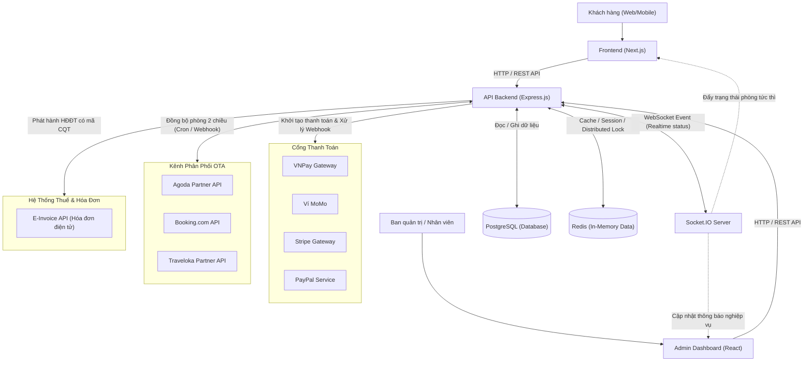

# Hệ Thống Quản Lý Khách Sạn — Starystal Hotel

## Chạy bản giao diện hiện tại

Mở **`index.html`** ở thư mục gốc bằng trình duyệt và chọn **Chọn vai trò** ở đầu trang. Bản giao diện dùng HTML, CSS và JavaScript thuần, chạy trực tiếp từ file với dữ liệu mẫu. Các thư mục `backend`, `frontend` và `admin` chứa mã nguồn cho hướng tích hợp sau này.

| Vai trò | Quyền trên giao diện mẫu |
| --- | --- |
| Guest | Xem phòng, tạo và hủy đặt phòng mẫu ở cổng khách |
| Receptionist · Tiếp tân | Đặt phòng, nhận phòng, trả phòng và theo dõi trạng thái phòng |
| Housekeeping · Nhân viên vệ sinh | Xem sơ đồ và cập nhật tác vụ của các phòng được giao |
| Manager | Phân công vệ sinh theo phòng, theo dõi vận hành và xem báo cáo |
| Owner / Admin | Các màn hình quản trị, gồm nhân sự và cấu hình |

Đặt phòng mẫu xuất hiện trong danh sách vận hành trên cùng trình duyệt. Thao tác nhận phòng, trả phòng và hoàn tất dọn phòng cập nhật sơ đồ phòng. Dữ liệu và vai trò mẫu được lưu trong bộ nhớ của trình duyệt. Ảnh minh họa được lưu trong `ui/images`. Nguồn ảnh gồm [ảnh bìa](https://images.unsplash.com/photo-1590490360182-c33d57733427), [phòng đôi](https://images.unsplash.com/photo-1631049307264-da0ec9d70304), [phòng đơn của Erik Mclean](https://www.pexels.com/photo/single-bed-in-room-9899861/) và [phòng gia đình của Quang Nguyen Vinh](https://www.pexels.com/photo/hotel-double-room-14021931/).

Quản lý chọn nhân viên phụ trách từng phòng trong mục **Phân công vệ sinh**. Khi tiếp tân trả phòng, phòng chuyển sang **Cần dọn** và hiện trong mục **Buồng phòng** của người được phân công. Nhân viên vệ sinh cập nhật công việc thành **Đang dọn** hoặc **Đã dọn**. Khi lưu **Đã dọn**, phòng chuyển về **Trống** và tiếp tân có thể nhận khách mới.

Có thể mở cùng file HTML trong nhiều tab của một trình duyệt để chọn các tài khoản mẫu khác nhau và xem thông báo bàn giao giữa các tab.

### Phòng và giá mẫu tại TP. Hồ Chí Minh

| Loại phòng | Số lượng | Bố trí | Giá mỗi đêm |
| --- | ---: | --- | ---: |
| Phòng đơn | 15 | 1 giường đơn, khu vệ sinh và tắm chung | 590.000 ₫ |
| Phòng đôi | 10 | 1 giường đôi, khu vệ sinh và tắm chung | 890.000 ₫ |
| Phòng gia đình | 5 | 2 giường đôi, nhà vệ sinh và phòng tắm tách riêng | 1.390.000 ₫ |

Sáu tầng có 5 phòng mỗi tầng. Tầng 1–5 có 2 phòng đơn, 2 phòng đôi, 1 phòng gia đình. Tầng 6 có 5 phòng đơn. Chọn **Xem sơ đồ phòng** để xem bản bố trí HTML/CSS và chi phí kỳ nghỉ.

Thời gian đặt trước tính đến giờ nhận phòng tại TP.HCM. Từ 24 giờ đến dưới 7 ngày, khách thanh toán đủ khi nhận phòng. Từ 7 đến 31 ngày, khách cọc mẫu 20% và thanh toán mẫu phần còn lại khi nhận phòng. Giá mẫu tính theo số đêm và các thao tác thanh toán được mô phỏng trên giao diện.

## Phạm vi và thiết kế dự kiến

Hệ thống quản lý khách sạn Starystal Hotel là giải pháp chuyển đổi số toàn diện và hiện đại dành cho vận hành khách sạn tiêu chuẩn quốc tế. Nền tảng được thiết kế với kiến trúc phân tán mạnh mẽ, kết hợp giữa cổng đặt phòng trực tuyến dành cho khách hàng (Guest Portal), bảng điều khiển quản trị tập trung (Admin Dashboard), hệ thống đồng bộ phòng đa kênh OTA (Channel Manager) và phân hệ tích hợp hóa đơn điện tử chuẩn quy định thuế Việt Nam. Với mục tiêu tối ưu hóa tỷ lệ lấp đầy phòng, tự động hóa quy trình nghiệp vụ lễ tân - buồng phòng và nâng cao trải nghiệm lưu trú của khách hàng, hệ thống đáp ứng đầy đủ các tiêu chuẩn khắt khe về hiệu năng, tính sẵn sàng cao và an toàn bảo mật dữ liệu.

---

## Tính Năng Chính

Hệ thống cung cấp một hệ sinh thái tính năng hoàn chỉnh, phục vụ đồng thời cho khách lưu trú và đội ngũ vận hành khách sạn:

### 1. Đặt phòng trực tuyến (Online Booking)
* **Tìm kiếm & Lọc phòng:** Tìm kiếm thông minh theo ngày nhận/trả phòng, số lượng khách, loại giường, tiện ích và mức giá.
* **Kiểm tra tình trạng phòng thực tế:** Kiểm tra phòng trống tức thì (real-time availability) hạn chế tình trạng trùng phòng.
* **Đặt theo hình thức linh hoạt:** Hỗ trợ đặt theo ngày/đêm tiêu chuẩn hoặc đặt theo giờ (day-use / short-stay).
* **Quản lý đơn đặt cá nhân:** Khách có thể tra cứu mã đặt phòng, chỉnh sửa yêu cầu đặc biệt và hủy phòng theo chính sách quy định.

### 2. Đăng ký & Đăng nhập (Authentication & Accounts)
* **Đa dạng hình thức xác thực:** Đăng ký bằng Email/Mật khẩu với cơ chế mã hóa bảo mật BCrypt và JWT token.
* **Đăng nhập một chạm (Social Login):** Tích hợp Google, Facebook và Zalo Login.
* **Xác thực OTP:** Gửi mã xác minh qua SMS (Twilio OTP) khi kích hoạt tài khoản hoặc khôi phục mật khẩu.
* **Hồ sơ thành viên:** Tích lũy điểm thưởng thành viên, lưu lịch sử đặt phòng và sở thích cá nhân.

### 3. Thanh toán đa kênh (Payment Gateway Integration)
* **Cổng thanh toán nội địa:** Tích hợp VNPay (QR Pay, thẻ nội địa, VNPAY-QR) và Ví điện tử MoMo.
* **Cổng thanh toán quốc tế:** Hỗ trợ Stripe và PayPal cho khách du lịch nước ngoài với bảo mật chuẩn PCI-DSS.
* **Thanh toán tại quầy:** Hỗ trợ tiền mặt, chuyển khoản ngân hàng và quẹt thẻ POS khi check-in/check-out.
* **Webhooks & Đối soát:** Cơ chế tự động nhận phản hồi kết quả giao dịch và đối soát trạng thái tức thì.

### 4. Quản lý phòng (Room Management)
* **Sơ đồ phòng trực quan (Room Matrix):** Theo dõi trạng thái tất cả phòng theo thời gian thực (Trống, Đang ở, Đang dọn, Bảo trì).
* **Cấu hình loại phòng:** Quản lý danh mục phòng (Deluxe, Suite, Executive,...), số lượng người tối đa, tiện nghi và thư viện ảnh.
* **Chính sách giá linh hoạt:** Thiết lập bảng giá theo mùa cao điểm, ngày lễ, cuối tuần và khuyến mãi Flash Sale.

### 5. Quản lý buồng phòng (Housekeeping)
* **Tự động phân công công việc:** Tự động tạo tác vụ vệ sinh khi khách làm thủ tục check-out.
* **Cập nhật trạng thái phòng tức thì:** Nhân viên dọn phòng cập nhật tiến độ (Cần dọn -> Đang dọn -> Đã kiểm tra -> Sẵn sàng đón khách) qua điện thoại/máy tính bảng.
* **Kiểm tra Minibar & Tài sản:** Báo cáo đồ uống minibar đã sử dụng và tài sản hư hại/bỏ quên vào hồ sơ thanh toán của khách.

### 6. Quản lý đa kênh (Channel Manager)
* **Kết nối 2 chiều với các OTA:** Đồng bộ kho phòng và giá bán tự động lên Agoda, Booking.com, Traveloka.
* **Cơ chế chống Overbooking:** Khóa phòng phân tán và cập nhật số lượng phòng khả dụng ngay khi có đặt phòng mới từ bất kỳ kênh nào.
* **Nhận đơn từ OTA qua Webhook:** Thu nhận thông tin đặt phòng tức thời từ đối tác OTA về cơ sở dữ liệu nội bộ.

### 7. Hóa đơn & Thuế (Invoicing & Tax Compliance)
* **Tự động xuất hóa đơn lưu trú:** Phân tách rõ ràng tiền phòng, phụ thu dịch vụ và đồ uống/thực phẩm.
* **Phân loại thuế suất chuẩn:** Tách riêng thuế GTGT (8% áp dụng đến hết năm 2026) và thuế tiêu thụ đặc biệt (rượu bia 65%, thuốc lá 75%).
* **Tích hợp Hóa đơn điện tử (E-Invoice):** Tự động phát hành hóa đơn điện tử có mã của cơ quan Thuế qua cổng API chuyên dụng.

### 8. Báo cáo & Thống kê (Reports & Analytics)
* **Báo cáo doanh thu:** Phân tích doanh thu theo ngày, tuần, tháng, quý; phân loại theo nguồn khách (Trực tiếp, OTA, Doanh nghiệp).
* **Chỉ số vận hành cốt lõi:** Đo lường tỷ lệ lấp đầy phòng (Occupancy Rate), ADR (Average Daily Rate) và RevPAR (Revenue Per Available Room).
* **Báo cáo tài chính & Thuế:** Báo cáo tổng hợp thuế đầu ra, sổ chi tiết doanh thu phục vụ quyết toán kế toán.

### 9. Phân quyền người dùng (Role-Based Access Control - RBAC)
* **Phân cấp vai trò nghiêm ngặt:** Chủ khách sạn, Lễ tân, Kế toán, Nhân viên buồng phòng.
* **Bảo mật truy cập:** Giới hạn phạm vi xem báo cáo tài chính, sửa đổi cấu hình hệ thống và phê duyệt miễn giảm phí.

---

## Kiến Trúc Hệ Thống

Kiến trúc hệ thống được xây dựng theo mô hình Client-Server hiện đại, phân tách độc lập giữa tầng giao diện người dùng, tầng nghiệp vụ API và các dịch vụ cơ sở hạ tầng nền tảng:



---

## Công Nghệ Sử Dụng

| Thành phần | Công nghệ | Mô tả |
| :--- | :--- | :--- |
| **Frontend** | Next.js 14, React, Tailwind CSS, TypeScript | Cổng đặt phòng trực tuyến dành cho khách hàng với khả năng tối ưu hóa SEO (SSR/SSG), giao diện chuẩn Responsive và tốc độ tải trang nhanh vượt trội. |
| **Backend** | Node.js, Express.js, TypeScript, Prisma ORM | Tầng xử lý nghiệp vụ API dạng RESTful chuẩn mực, quản lý mô hình dữ liệu quan hệ với Prisma ORM, kiểm soát luồng xử lý và dữ liệu an toàn. |
| **Admin** | React.js, Vite, Ant Design / Tailwind CSS | Trang tổng quan quản trị dành cho nhân viên lễ tân, kế toán, buồng phòng và người quản lý với các biểu đồ trực quan và bảng dữ liệu chuyên dụng. |
| **Database** | PostgreSQL 15 | Cơ sở dữ liệu quan hệ chính (RDBMS) lưu trữ thông tin khách hàng, phòng ốc, hóa đơn, giao dịch với tính toàn vẹn dữ liệu (ACID) cao. |
| **Cache & Queue** | Redis 7 | Bộ nhớ đệm dữ liệu truy vấn cao, lưu trữ phiên đăng nhập (session), quản lý khóa phân tán (Redlock) chống overbooking và hàng đợi tiến trình nền. |
| **Realtime** | Socket.IO | Kênh giao tiếp WebSocket hai chiều giúp đồng bộ tức thì trạng thái phòng trên sơ đồ buồng phòng và thông báo cho nhân viên. |
| **Authentication** | JWT, Passport.js, OAuth 2.0, Twilio SMS | Cơ chế cấp phát access token / refresh token an toàn; tích hợp đăng nhập qua Google, Facebook, Zalo và gửi mã OTP qua Twilio. |
| **Payment** | VNPay, MoMo, Stripe, PayPal SDKs | Cổng kết nối thanh toán linh hoạt cho khách hàng nội địa và quốc tế, hỗ trợ hoàn tiền và tự động nhận kết quả thanh toán an toàn. |
| **Deployment** | Docker, Docker Compose, Nginx Reverse Proxy | Đóng gói toàn bộ ứng dụng vào container độc lập; định tuyến và cân bằng tải an toàn kèm chứng chỉ SSL bằng Nginx. |

---

## Cấu Trúc Thư Mục

```text
hotel-management/
├── .env.example                     # Tệp mẫu cấu hình các biến môi trường
├── docker-compose.yml              # Cấu hình khởi chạy toàn bộ dịch vụ với Docker
├── README.md                       # Tài liệu hướng dẫn kỹ thuật dự án
├── nginx/
│   ├── nginx.conf                  # File cấu hình định tuyến và reverse proxy Nginx
│   └── certs/                      # Thư mục chứa chứng chỉ bảo mật SSL/TLS
├── backend/
│   ├── Dockerfile                  # Dockerfile build image cho ứng dụng API Backend
│   ├── package.json                # Quản lý dependencies và scripts của Backend
│   ├── tsconfig.json               # Cấu hình biên dịch TypeScript cho Backend
│   ├── prisma/
│   │   ├── schema.prisma           # Định nghĩa cấu trúc Database (Models, Relations, Enums)
│   │   └── seed.ts                 # Script khởi tạo dữ liệu mẫu ban đầu (phòng, tài khoản quản trị)
│   └── src/
│       ├── server.ts               # Điểm khởi động ứng dụng Express & Socket.IO server
│       ├── config/                 # Cấu hình kết nối Database, Redis, biến môi trường
│       ├── controllers/            # Tầng xử lý nhận yêu cầu và phản hồi HTTP
│       │   ├── auth.controller.ts
│       │   ├── room.controller.ts
│       │   ├── booking.controller.ts
│       │   ├── payment.controller.ts
│       │   ├── invoice.controller.ts
│       │   ├── housekeeping.controller.ts
│       │   ├── staff.controller.ts
│       │   ├── channel.controller.ts
│       │   └── report.controller.ts
│       ├── middlewares/            # Tầng middleware xác thực token, kiểm tra quyền và validate dữ liệu
│       │   ├── auth.middleware.ts
│       │   ├── role.middleware.ts
│       │   └── error.middleware.ts
│       ├── routes/                 # Khai báo các router API cho từng phân hệ nghiệp vụ
│       │   ├── auth.routes.ts
│       │   ├── room.routes.ts
│       │   ├── booking.routes.ts
│       │   ├── payment.routes.ts
│       │   ├── invoice.routes.ts
│       │   ├── housekeeping.routes.ts
│       │   ├── staff.routes.ts
│       │   ├── channel.routes.ts
│       │   └── report.routes.ts
│       ├── services/               # Tầng xử lý logic nghiệp vụ trọng lõi
│       │   ├── pricing.service.ts
│       │   ├── channel-manager.service.ts
│       │   ├── payment.service.ts
│       │   └── invoice.service.ts
│       ├── sockets/                # Quản lý sự kiện WebSocket cập nhật trạng thái phòng
│       │   └── room.socket.ts
│       └── workers/                # Các tiến trình chạy nền (Background Cron Worker)
│           └── channel-sync.worker.ts
├── frontend/                       # Ứng dụng cổng đặt phòng cho khách (Next.js)
│   ├── Dockerfile
│   ├── package.json
│   ├── next.config.js
│   ├── tailwind.config.js
│   └── src/
│       ├── app/                    # App Router Next.js (Trang chủ, Tra cứu phòng, Đặt phòng, Thanh toán)
│       ├── components/             # Các component tái sử dụng (Header, RoomCard, BookingForm,...)
│       ├── hooks/                  # Custom React hooks
│       └── lib/                    # Các module tiện ích, HTTP client API kết nối Backend
└── admin/                          # Ứng dụng quản trị nghiệp vụ nội bộ (React SPA)
    ├── Dockerfile
    ├── package.json
    ├── vite.config.ts
    └── src/
        ├── pages/                  # Các màn hình nghiệp vụ (Sơ đồ phòng, Đặt phòng, Thu ngân, Buồng phòng)
        ├── components/             # Các UI components quản trị (Sidebar, MetricCards, Modals)
        └── services/               # Module gọi API quản trị tới Backend
```

---

## Hướng Dẫn Triển Khai Dự Kiến Khi Tích Hợp Backend

### Yêu Cầu Tiên Quyết
* **Node.js**: Phiên bản 18.x LTS hoặc mới hơn.
* **Docker & Docker Compose**: Phiên bản Docker Engine 24.x trở lên.
* **PostgreSQL**: Phiên bản 15 (nếu cài đặt thủ công ngoài Docker).
* **Redis**: Phiên bản 7 (nếu cài đặt thủ công ngoài Docker).

---

### Triển Khai Với Docker Compose (Khuyến Nghị)

Đây là cách nhanh nhất và chuẩn xác nhất để khởi chạy trọn vẹn toàn bộ các service của hệ sinh thái:

1. **Sao chép mã nguồn và chuyển vào thư mục dự án:**
   ```bash
   cd "d:/Đề án/Đề Án/hotel-management"
   ```

2. **Cấu hình biến môi trường:**
   Tạo tệp cấu hình `.env` dựa trên file mẫu:
   ```bash
   cp .env.example .env
   ```
   *(Mở tệp `.env` và cập nhật các khóa bí mật hoặc thông số kết nối nếu cần).*

3. **Khởi chạy toàn bộ hệ thống bằng Docker Compose:**
   ```bash
   docker-compose up -d --build
   ```

4. **Thực thi dịch chuyển cấu trúc bảng (Migration) và khởi tạo dữ liệu mẫu:**
   ```bash
   docker-compose exec api npx prisma migrate deploy
   docker-compose exec api npx prisma db seed
   ```

5. **Truy cập ứng dụng:**
   * **Cổng đặt phòng khách hàng (Frontend):** `http://localhost:3000` (hoặc thông qua Nginx tại `http://localhost`)
   * **Bảng điều khiển quản trị (Admin):** `http://localhost:3001` (hoặc `http://localhost/admin/`)
   * **Máy chủ API Backend:** `http://localhost:8000/api`

---

### Chạy Thủ Công Từng Phân Hệ (Local Development)

Nếu bạn cần phát triển cục bộ và debug từng dịch vụ độc lập:

#### 1. Khởi động Cơ sở dữ liệu & Redis
Đảm bảo PostgreSQL đang chạy trên cổng `5432` và Redis trên cổng `6379`. Bạn có thể dùng Docker riêng cho DB & Redis:
```bash
docker-compose up -d db redis
```

#### 2. Cấu hình & Chạy API Backend
```bash
cd backend
npm install

# Tạo bảng dữ liệu và nạp dữ liệu khởi tạo
npx prisma migrate dev --name init
npx prisma db seed

# Chạy server ở chế độ phát triển
npm run dev
```

#### 3. Chạy Khách hàng Frontend (Next.js)
```bash
cd ../frontend
npm install
npm run dev
```
Ứng dụng sẽ hoạt động tại địa chỉ: `http://localhost:3000`.

#### 4. Chạy Trang Quản Trị (Admin Dashboard)
```bash
cd ../admin
npm install
npm run dev
```
Trang quản trị sẽ hoạt động tại địa chỉ: `http://localhost:3001`.

---

## Biến Môi Trường

Bảng chi tiết các biến môi trường được định nghĩa trong `.env.example`:

| Biến Môi Trường | Mô Tả Chức Năng | Giá Trị Mặc Định / Ví Dụ |
| :--- | :--- | :--- |
| `DATABASE_URL` | Chuỗi kết nối cơ sở dữ liệu PostgreSQL | `postgresql://hotel:hotel_secret@db:5432/hotel_management` |
| `REDIS_URL` | Chuỗi kết nối máy chủ bộ nhớ đệm Redis | `redis://redis:6379` |
| `JWT_SECRET` | Khóa bí mật dùng để ký và xác thực JWT token | `change-me-to-a-random-string` |
| `JWT_EXPIRES_IN` | Thời gian sống của mã phiên JWT | `7d` |
| `GOOGLE_CLIENT_ID` | Client ID ứng dụng Google OAuth 2.0 | `""` |
| `GOOGLE_CLIENT_SECRET` | Khóa bí mật Client Secret Google OAuth | `""` |
| `FACEBOOK_APP_ID` | App ID ứng dụng Facebook Login | `""` |
| `FACEBOOK_APP_SECRET` | Khóa bí mật App Secret Facebook | `""` |
| `ZALO_APP_ID` | App ID đăng nhập qua nền tảng Zalo | `""` |
| `ZALO_APP_SECRET` | Khóa bảo mật Zalo App Secret | `""` |
| `TWILIO_ACCOUNT_SID` | Định danh tài khoản gửi SMS Twilio OTP | `""` |
| `TWILIO_AUTH_TOKEN` | Mã ủy quyền Auth Token Twilio | `""` |
| `TWILIO_PHONE_NUMBER` | Số điện thoại gửi tin nhắn OTP Twilio | `""` |
| `VNPAY_TMN_CODE` | Mã định danh Merchant tại cổng VNPay | `""` |
| `VNPAY_HASH_SECRET` | Khóa bí mật mã hóa checksum giao dịch VNPay | `""` |
| `VNPAY_URL` | Đường dẫn API thanh toán VNPay Sandbox | `https://sandbox.vnpayment.vn/paymentv2/vpcpay.html` |
| `VNPAY_RETURN_URL` | URL chuyển hướng sau khi hoàn tất giao dịch VNPay | `http://localhost:3000/payment/callback` |
| `MOMO_PARTNER_CODE` | Mã đối tác tích hợp cổng ví điện tử MoMo | `""` |
| `MOMO_ACCESS_KEY` | Khóa truy cập công khai API MoMo | `""` |
| `MOMO_SECRET_KEY` | Khóa bí mật ký dữ liệu giao dịch MoMo | `""` |
| `MOMO_ENDPOINT` | Đường dẫn kết nối API cổng thanh toán MoMo | `https://test-payment.momo.vn/v2/gateway/api` |
| `STRIPE_SECRET_KEY` | Khóa bảo mật thanh toán quốc tế Stripe | `""` |
| `STRIPE_PUBLISHABLE_KEY`| Khóa công khai tích hợp trên giao diện Stripe | `""` |
| `STRIPE_WEBHOOK_SECRET` | Khóa xác thực chữ ký Webhook từ Stripe | `""` |
| `PAYPAL_CLIENT_ID` | Mã định danh ứng dụng PayPal REST API | `""` |
| `PAYPAL_CLIENT_SECRET` | Mã bí mật kết nối thanh toán PayPal | `""` |
| `PAYPAL_MODE` | Môi trường hoạt động của cổng PayPal | `sandbox` |
| `EINVOICE_API_URL` | Địa chỉ API kết nối hệ sinh thái Hóa đơn điện tử | `""` |
| `EINVOICE_API_KEY` | Token/Khóa xác thực dịch vụ HĐĐT | `""` |
| `EINVOICE_COMPANY_TAX_CODE`| Mã số thuế của doanh nghiệp vận hành khách sạn | `""` |
| `AGODA_API_KEY` | Khóa API kết nối hệ thống đối tác Agoda | `""` |
| `BOOKING_COM_API_KEY` | Khóa API kết nối hệ thống đối tác Booking.com | `""` |
| `TRAVELOKA_API_KEY` | Khóa API kết nối kênh đặt phòng Traveloka | `""` |
| `NODE_ENV` | Môi trường thực thi ứng dụng | `development` |
| `BACKEND_PORT` | Cổng lắng nghe của máy chủ API Backend | `8000` |
| `FRONTEND_PORT` | Cổng hoạt động của trang khách hàng Next.js | `3000` |
| `ADMIN_PORT` | Cổng hoạt động của trang quản trị Admin | `3001` |

---

## API Documentation

Hệ thống cung cấp danh sách đầy đủ các RESTful endpoint được chuẩn hóa:

| Phân Hệ | Phương Thức | Đường Dẫn | Mô Tả Chức Năng | Yêu Cầu Xác Thực |
| :--- | :--- | :--- | :--- | :--- |
| **Auth** | `POST` | `/api/auth/register` | Đăng ký tài khoản khách hàng mới | Public |
| **Auth** | `POST` | `/api/auth/login` | Đăng nhập hệ thống & nhận JWT | Public |
| **Auth** | `POST` | `/api/auth/social-login` | Đăng nhập bằng Google / Facebook / Zalo | Public |
| **Auth** | `POST` | `/api/auth/otp-verify` | Xác minh mã OTP số điện thoại | Public |
| **Auth** | `POST` | `/api/auth/refresh-token` | Cấp mới access token khi hết hạn | Public |
| **Auth** | `GET` | `/api/auth/profile` | Xem thông tin tài khoản cá nhân hiện tại | Bearer Token |
| **Rooms** | `GET` | `/api/rooms` | Danh sách phòng kèm bộ lọc trạng thái & loại | Public |
| **Rooms** | `GET` | `/api/rooms/:id` | Xem chi tiết thông số & hình ảnh phòng | Public |
| **Rooms** | `POST` | `/api/rooms` | Thêm mới phòng vào hệ thống | Admin / Lễ tân |
| **Rooms** | `PUT` | `/api/rooms/:id` | Cập nhật thông tin phòng, tiện nghi, loại phòng | Admin |
| **Rooms** | `PATCH` | `/api/rooms/:id/status` | Cập nhật trạng thái phòng (Trống/Bảo trì/Sạch) | Admin / Lễ tân / Buồng phòng |
| **Bookings** | `POST` | `/api/bookings` | Tạo mới đơn đặt phòng (theo ngày hoặc theo giờ) | Khách / Lễ tân |
| **Bookings** | `GET` | `/api/bookings/availability` | Kiểm tra phòng trống theo khoảng thời gian | Public |
| **Bookings** | `GET` | `/api/bookings/:id` | Lấy thông tin chi tiết đơn đặt phòng | Bearer Token |
| **Bookings** | `POST` | `/api/bookings/:id/cancel` | Hủy đặt phòng theo điều khoản hoàn hủy | Khách / Lễ tân |
| **Bookings** | `POST` | `/api/bookings/:id/check-in` | Thực hiện thủ tục nhận phòng cho khách | Lễ tân |
| **Bookings** | `POST` | `/api/bookings/:id/check-out` | Thực hiện thủ tục trả phòng & đối soát chi phí | Lễ tân |
| **Payments** | `POST` | `/api/payments/create-intent` | Khởi tạo giao dịch thanh toán (VNPay, MoMo,...) | Bearer Token |
| **Payments** | `GET/POST`| `/api/payments/callback/:gateway` | Tiếp nhận và xác thực kết quả thanh toán | Public (Gateway Callback) |
| **Payments** | `GET` | `/api/payments/:id/status` | Tra cứu trạng thái thanh toán của hóa đơn | Bearer Token |
| **Invoices** | `POST` | `/api/invoices` | Khởi tạo bảng kê hóa đơn khi thanh toán | Lễ tân / Kế toán |
| **Invoices** | `GET` | `/api/invoices/booking/:bookingId` | Tra cứu hóa đơn theo mã đơn đặt phòng | Bearer Token |
| **Invoices** | `POST` | `/api/invoices/:id/export-einvoice` | Phát hành hóa đơn điện tử chính thức qua API | Kế toán / Admin |
| **Invoices** | `GET` | `/api/invoices` | Danh sách lịch sử hóa đơn kế toán | Kế toán / Admin |
| **Housekeeping** | `GET` | `/api/housekeeping/tasks` | Danh sách công việc dọn dẹp cần thực hiện | Buồng phòng / Lễ tân |
| **Housekeeping** | `POST` | `/api/housekeeping/assign` | Phân công buồng phòng dọn dẹp cụ thể | Lễ tân / Quản lý |
| **Housekeeping** | `PATCH` | `/api/housekeeping/:id/status` | Cập nhật tiến độ dọn & kiểm tra minibar | Buồng phòng |
| **Staff** | `GET` | `/api/staff` | Danh sách nhân viên khách sạn | Admin |
| **Staff** | `POST` | `/api/staff` | Thêm mới nhân sự & phân quyền vai trò | Admin |
| **Staff** | `PUT` | `/api/staff/:id/role` | Điều chỉnh chức vụ và quyền hạn | Admin |
| **Staff** | `DELETE` | `/api/staff/:id` | Vô hiệu hóa tài khoản nhân sự | Admin |
| **Channels** | `POST` | `/api/channels/sync` | Kích hoạt đồng bộ phòng lên các OTA | Admin / Hệ thống |
| **Channels** | `POST` | `/api/channels/webhook/:channel` | Tiếp nhận đơn đặt phòng mới từ OTA | Public (OTA Webhook) |
| **Channels** | `GET` | `/api/channels/status` | Kiểm tra tình trạng kết nối các kênh OTA | Admin |
| **Reports** | `GET` | `/api/reports/revenue` | Báo cáo doanh thu theo mốc thời gian | Admin / Kế toán |
| **Reports** | `GET` | `/api/reports/occupancy` | Báo cáo tỷ lệ lấp đầy phòng theo kỳ | Admin / Lễ tân |
| **Reports** | `GET` | `/api/reports/tax-summary` | Tổng hợp thuế GTGT và thuế đặc biệt theo quý | Admin / Kế toán |

---

## Cơ Chế Tính Tiền

Hệ thống áp dụng thuật toán tính giá phòng thông minh, hỗ trợ đa dạng mô hình lưu trú kết hợp quy chuẩn tính thuế theo Luật Quản lý Thuế Việt Nam:

### 1. Thuật Toán Tính Giá Theo Giờ
* **Block 2 giờ đầu tiên:** Áp dụng mức giá cơ bản theo giờ:
  $$\text{Giá 2 giờ đầu} = \text{baseRateHourly}$$
* **Từ giờ thứ 3 trở đi:** Mỗi giờ phát sinh tính thêm $30\%$ của giá cơ bản theo giờ:
  $$\text{Tiền phát sinh mỗi giờ} = \text{baseRateHourly} \times 0.3$$
* **Công thức tổng quát khi $H > 2$:**
  $$\text{Tổng tiền giờ} = \text{baseRateHourly} + \left[(H - 2) \times (\text{baseRateHourly} \times 0.3)\right]$$
  *(Nếu tổng tiền theo giờ vượt quá mức giá theo ngày, hệ thống sẽ tự động giới hạn ở mức giá theo ngày tối ưu nhất cho khách).*

### 2. Thuật Toán Tính Giá Theo Ngày / Đêm
* **Ngày thường (Thứ 2 – Thứ 6):** Tính theo đơn giá ngày tiêu chuẩn `baseRateDaily`.
* **Cuối tuần (Thứ 7 – Chủ Nhật):** Tự động áp dụng hệ số phụ thu cuối tuần `weekendRate` (thường cao hơn 15% – 25%).
* **Ngày Lễ / Tết:** Áp dụng biểu giá sự kiện đặc biệt `holidayRate` theo lịch cấu hình trong hệ thống quản trị.

### 3. Chính Sách Phụ Thu (Surcharges)
* **Nhận phòng sớm (Early Check-in):**
  * Trước 06:00 sáng: Tính $100\%$ đơn giá một đêm.
  * Từ 06:00 đến 09:00: Tính $50\%$ đơn giá một đêm.
  * Từ 09:00 đến trước 14:00: Tính $30\%$ đơn giá một đêm.
* **Trả phòng muộn (Late Check-out):**
  * Từ 12:00 đến 15:00: Phụ thu $30\%$ đơn giá một đêm.
  * Từ 15:00 đến 18:00: Phụ thu $50\%$ đơn giá một đêm.
  * Sau 18:00: Tính phụ thu trọn gói $100\%$ một đêm tiếp theo.
* **Dịch vụ phát sinh:** Nước uống, đồ ăn minibar, dịch vụ giặt là, đưa đón sân bay và ẩm thực nhà hàng.

### 4. Thuế Giá Trị Gia Tăng (VAT)
Theo chính sách giảm thuế kích cầu du lịch hiện hành, thuế suất VAT đối với dịch vụ lưu trú và ăn uống được áp dụng $8\%$ (hiệu lực đến hết ngày 31/12/2026):

```typescript
// Công thức tính thuế VAT theo Luật Thuế hiện hành
function calculateVAT(netRevenue: number): number {
  const VAT_RATE = 0.08; // 8% áp dụng đến 31/12/2026
  return Math.round(netRevenue * VAT_RATE);
}

// Tổng giá trị thanh toán bao gồm VAT
const totalAmountWithVAT = netRevenue + calculateVAT(netRevenue);
```

### 5. Thuế Tiêu Thụ Đặc Biệt (TTĐB)
Đối với các dịch vụ bổ sung thuộc diện chịu thuế tiêu thụ đặc biệt phục vụ tại khách sạn, hệ thống bắt buộc phân loại và tách dòng độc lập trên hóa đơn:
* **Đồ uống có cồn (Rượu, Bia phục vụ tại quầy bar/minibar):** Chịu thuế suất TTĐB **$65\%$**.
* **Thuốc lá / Xì gà:** Chịu thuế suất TTĐB **$75\%$**.
* *Nguyên tắc xuất hóa đơn:* Thuế TTĐB được cấu thành trước trong giá tính thuế GTGT, đồng thời hiển thị chi tiết phụ lục để khách hàng và cơ quan thuế giám sát rõ ràng.

### 6. Quy Trình Xuất Hóa Đơn Điện Tử (E-Invoice API)
1. **Kiểm tra thông tin:** Khi lễ tân hoàn tất thủ tục Check-out, hệ thống kiểm tra thông tin pháp nhân (Tên đơn vị, Mã số thuế, Địa chỉ công ty, Email nhận HĐĐT).
2. **Khởi tạo bảng kê dữ liệu:** Gom toàn bộ chi phí lưu trú, tiền ăn uống và dịch vụ phụ trội, tính toán chính xác tiền thuế GTGT $8\%$ và thuế TTĐB tương ứng.
3. **Ký số & Gửi yêu cầu qua API:** Hệ thống tự động gửi gói dữ liệu JSON tới nhà cung cấp giải pháp Hóa đơn điện tử (VNPT, Viettel, MISA,...).
4. **Cấp mã Cơ quan Thuế & Phát hành:** Nhận lại mã xác thực của Tổng cục Thuế, tạo mã tra cứu và gửi email tự động đính kèm file XML/PDF có chữ ký số cho khách hàng.

---

## Phân Quyền Nhân Sự

Hệ thống thiết lập ma trận kiểm soát truy cập phân tầng (Role-Based Access Control) chặt chẽ giữa các bộ phận trong khách sạn:

| Danh Mục Quyền Hạn | Chủ Khách Sạn (Owner/Admin) | Lễ Tân (Receptionist) | Kế Toán (Accountant) | Buồng Phòng (Housekeeping) |
| :--- | :---: | :---: | :---: | :---: |
| **Quản lý cấu hình phòng** | ✅ | ❌ | ❌ | ❌ |
| **Theo dõi sơ đồ buồng phòng** | ✅ | ✅ | ❌ | ✅ |
| **Tạo & Thay đổi đơn đặt phòng** | ✅ | ✅ | ❌ | ❌ |
| **Thực hiện Check-in / Check-out** | ✅ | ✅ | ❌ | ❌ |
| **Thu tiền & Quản lý thanh toán** | ✅ | ✅ | ✅ | ❌ |
| **Xuất & Kiểm duyệt Hóa đơn VAT** | ✅ | ❌ | ✅ | ❌ |
| **Xem báo cáo tài chính & Doanh thu**| ✅ | ❌ | ✅ | ❌ |
| **Quản lý & Cập nhật Buồng phòng** | ✅ | ✅ | ❌ | ✅ |
| **Quản lý danh sách nhân sự** | ✅ | ❌ | ❌ | ❌ |
| **Cài đặt hệ thống & Kết nối OTA** | ✅ | ❌ | ❌ | ❌ |

---

## Channel Manager (Quản Lý Đa Kênh)

Hệ sinh thái Channel Manager đóng vai trò huyết mạch trong việc gia tăng doanh thu và phòng ngừa rủi ro vận hành phòng trên các nền tảng OTA:

```text
  [ Cơ Sở Dữ Liệu Khách Sạn ] 
           │
           ▼ (Distributed Redlock)
  [ Channel Sync Worker ] ────────────── Cron 5 phút / Event-Driven
           │
     ┌─────┴──────────────┬──────────────────┐
     ▼                    ▼                  ▼
[ Agoda API ]     [ Booking.com API ]   [ Traveloka API ]
```

### 1. Đồng Bộ Lịch Phòng Định Kỳ (Cron 5 Phút)
* Một tiến trình nền độc lập (`channel-sync.worker.ts`) chạy theo chu kỳ mỗi **5 phút một lần** để quét toàn bộ trạng thái phòng trống trong 365 ngày tiếp theo.
* Số lượng phòng trống thực tế (Allotment) cùng bảng giá phòng mới nhất sẽ được đóng gói và đẩy (push) đồng thời qua API tới các kênh OTA: **Agoda, Booking.com, Traveloka**.

### 2. Tiếp Nhận Đơn Đặt Tức Thì (Realtime Webhook)
* Khi khách hàng đặt phòng trên Agoda, Booking.com hoặc Traveloka, hệ thống OTA sẽ kích hoạt gửi ngay HTTP POST Webhook đến hệ thống API Backend.
* Backend xác thực chữ ký số (Webhook Signature), giải mã thông tin khách hàng, số đêm lưu trú và tự động ghi nhận đơn đặt phòng vào cơ sở dữ liệu nội bộ.

### 3. Cơ Chế Chống Bán Vượt / Trùng Phòng (Anti-Overbooking Logic)
* **Khóa phân tán (Distributed Lock with Redis):** Khi có bất kỳ giao dịch đặt phòng nào bắt đầu (từ website nội bộ hoặc từ một kênh OTA), hệ thống sẽ lập tức khóa tài nguyên phòng tương ứng thông qua cơ chế Redis Lock trong vài giây.
* **Nguyên tắc giao dịch nguyên tử (ACID Transaction):** Sau khi xác nhận ghi nhận phòng thành công, số lượng phòng trống của phân hạng đó trên hệ thống lập tức giảm xuống.
* **Đẩy tín hiệu cập nhật tức thì (Event-Driven Push):** Hệ thống không đợi chu kỳ 5 phút mà sẽ bắn ngay lập tức sự kiện cập nhật số phòng còn lại về tất cả các kênh OTA còn lại để khóa phòng, triệt tiêu hoàn toàn nguy cơ Overbooking.

---

## Chi Phí Triển Khai

Bảng ước tính ngân sách đầu tư xây dựng và duy trì hệ thống quản lý khách sạn Starystal Hotel:

| Hạng Mục | Chi Tiết Kỹ Thuật & Phạm Vi Cung Cấp | Mức Giá Tham Khảo |
| :--- | :--- | :--- |
| **Thiết kế & Xây dựng Website** | Giao diện đặt phòng tùy biến, chuẩn SEO, tối ưu di động, hệ thống quản trị CMS cao cấp | 3.500.000 – 50.000.000 VNĐ *(Tùy độ tùy biến)* |
| **Tên Miền (Domain)** | Tên miền quốc tế `.com` hoặc thương hiệu quốc gia Việt Nam `.vn` / `.com.vn` | 300.000 – 800.000 VNĐ / năm |
| **Máy Chủ Lưu Trữ (Hosting / VPS)**| Đám mây VPS tiêu chuẩn 4 Core CPU, 8GB RAM, SSD NVMe chịu tải cao cho Database & Docker | 1.500.000 – 5.000.000 VNĐ / năm |
| **Chứng Chỉ Bảo Mật SSL** | Chứng chỉ mã hóa dữ liệu Let's Encrypt hoặc chứng chỉ xác minh doanh nghiệp tổ chức (OV/EV SSL) | Miễn phí – 2.000.000 VNĐ / năm |
| **Phí Cổng Thanh Toán** | Chi phí xử lý giao dịch qua cổng VNPay, MoMo, thẻ Visa/Mastercard nội địa và quốc tế | 1.5% – 3.0% / giá trị mỗi giao dịch |
| **Phần Mềm Quản Lý Khách Sạn** | Chi phí duy trì bản quyền hệ thống, cập nhật phiên bản, bảo trì máy chủ và hỗ trợ kỹ thuật 24/7 | Hình thức thuê bao (SaaS) theo tháng hoặc mua trọn gói |

---

## License

Dự án được phát hành và bảo hộ theo điều khoản của giấy phép mã nguồn mở **MIT License**.

Bản quyền sở hữu thuộc về:
```text
Copyright (c) 2024 Grand Saigon Hotel Management System.
All rights reserved.
```
Quyền sử dụng, sửa đổi và phân phối mã nguồn được cấp tự do theo các điều kiện quy định trong MIT License.
